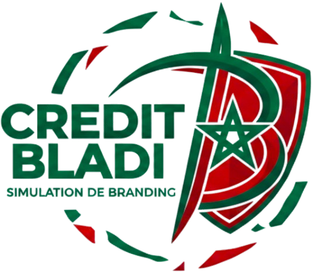

<p align="center">
  
</p>

# Credit Bladi — Docs & Project Hub

Moroccan credit platform built on Bank Al-Maghrib (BAM) rules, from the public simulation to the repaid loan.
This repo is the **entry point** for the project: it doesn't contain any code, only the links
and context a developer, tester, or manager needs to find the right repo.

**Current version: 2.1.0**, on the `release/2.1.0` branch of both repos.

## Live demo in your browser (no install)

Open the app directly, with no backend and no setup:

**https://louziamine.github.io/---Bladi-Credit-Portal---/**

This runs the frontend on its own with an in-browser backend, so every bit of data stays in your browser and nothing is sent to a server. You get the four journeys (mortgage credit, company investment, client portal, administration) with the same seeded accounts as the real app. Sign in as `admin` / `admin123`; every other manager uses the password `demo123`. The "DÉMO" bar at the bottom lists all accounts and lets you switch from one responsible to the next in one click. It can also be installed as an app and works offline.

## Repos

| Repo | Role | Stack | Branch |
|---|---|---|---|
| [`---Credit-Bladi---`](https://github.com/LouziAmine/---Credit-Bladi---/tree/release/2.1.0) | **Backend** (API) | Java 25, Spring Boot 4.0.6 | `release/2.1.0` |
| [`---Bladi-Credit-Portal---`](https://github.com/LouziAmine/---Bladi-Credit-Portal---/tree/release/2.1.0) | **Frontend** (web app) | Angular 22, TypeScript | `release/2.1.0` |

## What is Credit Bladi?

Credit Bladi covers the whole life of a credit:

- **Public simulations**: individual mortgage, **Conventional** (interest-based) or **Mourabaha**
  (Sharia-compliant, participative), and company investment loans. Pricing follows the applicant's
  professional status, each with its own BAM-regulated rate calculation.
- **Instruction**: reception and classification of the request, client invitation, documents, e-mails
  and SMS, four-eyes review up to the committee decision.
- **Credit file after approval**: disbursement, repayment schedule, payments, late interest and early
  repayment.
- **Client and company portal**, so the borrower follows their file.
- **Administration** (role-gated): regulatory parameters, staff accounts, compliance audit trail, Excel
  import and reminders.

## 🎥 Full product demo (2.1.0)

A 22-minute walkthrough of the real application, presented by Nisrine Mernissi (functional lead) and
Ilyas Bennis (technical lead): installation in one command, the mortgage and company credit journeys end
to end, administration, the documented API, then every test and report — unit, API, end-to-end, Postman,
performance and security.

[](https://www.youtube.com/watch?v=Tox1_ses6v4)

| Time | Chapter |
|---|---|
| [00:00](https://www.youtube.com/watch?v=Tox1_ses6v4&t=0s) | Introduction |
| [00:26](https://www.youtube.com/watch?v=Tox1_ses6v4&t=26s) | Installation in one command |
| [01:18](https://www.youtube.com/watch?v=Tox1_ses6v4&t=78s) | Mortgage simulation |
| [02:29](https://www.youtube.com/watch?v=Tox1_ses6v4&t=149s) | Investment credit simulation |
| [03:21](https://www.youtube.com/watch?v=Tox1_ses6v4&t=201s) | Reception and classification |
| [04:26](https://www.youtube.com/watch?v=Tox1_ses6v4&t=266s) | Invitation and client portal |
| [05:22](https://www.youtube.com/watch?v=Tox1_ses6v4&t=322s) | Documents, e-mails and SMS |
| [07:03](https://www.youtube.com/watch?v=Tox1_ses6v4&t=423s) | Instruction, four-eyes review and decision |
| [08:41](https://www.youtube.com/watch?v=Tox1_ses6v4&t=521s) | Disbursement and credit file |
| [09:56](https://www.youtube.com/watch?v=Tox1_ses6v4&t=596s) | Payments and early repayment |
| [11:07](https://www.youtube.com/watch?v=Tox1_ses6v4&t=667s) | Company credit end to end |
| [13:25](https://www.youtube.com/watch?v=Tox1_ses6v4&t=805s) | Company access |
| [14:49](https://www.youtube.com/watch?v=Tox1_ses6v4&t=889s) | Parameters and audit |
| [16:07](https://www.youtube.com/watch?v=Tox1_ses6v4&t=967s) | Excel import and reminders |
| [17:08](https://www.youtube.com/watch?v=Tox1_ses6v4&t=1028s) | Documented API |
| [17:48](https://www.youtube.com/watch?v=Tox1_ses6v4&t=1068s) | Automated tests |
| [19:37](https://www.youtube.com/watch?v=Tox1_ses6v4&t=1177s) | Performance and security |
| [21:58](https://www.youtube.com/watch?v=Tox1_ses6v4&t=1318s) | Conclusion |

The 1.1.0 onboarding walkthrough (clone, install, run, test) is still
[available here](https://www.youtube.com/watch?v=uX9JC3fSl5s).

## Quality and tests

| Area | Tool |
|---|---|
| Backend unit tests | JUnit |
| API scenarios | Karate (260 scenarios on the running app) |
| Frontend unit tests | Vitest |
| End to end | Playwright, driving a real browser on the app and the API |
| API collection | Postman, every current endpoint, replayed by Newman |
| Load | Gatling (about 6,000 requests, 99.7 % success on 2.1.0) |
| Front quality | Lighthouse (performance, accessibility, best practices) |
| Security | ESLint security rules, Checkstyle, dependency audit, OWASP ZAP scan |

Each repo's `docs/testing.md` explains how to run them and what each report shows.

## Who does what

- **Developer**: pick the repo matching what you're working on (backend API vs. frontend UI).
  Each repo's own README has the full setup (Quick Start, environment variables, run locally).
- **Tester**: both repos ship a `./run-tests.sh` interactive menu (unit, integration/E2E,
  performance, security scans — SAST/SCA/DAST). The backend's `postman/` folder holds the
  ready-to-import Postman collection and environment.
- **Manager / PO**: try the [live demo](https://louziamine.github.io/---Bladi-Credit-Portal---/) first, then watch the demo video above, then read the backend's
  `docs/mortgage-credit-workflow.md` and `docs/enterprise-credit-workflow.md` for the business rules, and
  the frontend's `docs/business-workflow.md` for the screen-by-screen journeys.

## Running the full stack locally

Clone both repos side by side, on `release/2.1.0`.

**Everything in Docker** (one command):

```bash
git clone -b release/2.1.0 https://github.com/LouziAmine/---Credit-Bladi---.git
git clone -b release/2.1.0 https://github.com/LouziAmine/---Bladi-Credit-Portal---.git
cd ./---Credit-Bladi---
docker compose --profile app up -d --build
```

**Apps on the machine** (faster to iterate):

1. `docker compose up -d` in `---Credit-Bladi---` (PostgreSQL, ClamAV, Mailpit)
2. Backend: `./mvnw spring-boot:run -Dspring-boot.run.profiles=dev` → `http://localhost:8080`
3. Frontend (`---Bladi-Credit-Portal---`): `npm ci && npm start` → `http://localhost:4200`

| | URL |
|---|---|
| Portal | `http://localhost:4200` |
| Swagger UI | `http://localhost:8080/swagger/credit-bladi/v3/swagger-ui.html` |
| Mailpit (e-mails and SMS in dev) | `http://localhost:8025` |

Demo login: `admin` / `admin123`. The backend README lists the requirements (Java 25, Docker Compose v2.24+,
Node.js 22.22+ or 24.15+) and a troubleshooting table.

## Contact

**Amine Louzi** (louzi.amine.pro.pro@gmail.com)
